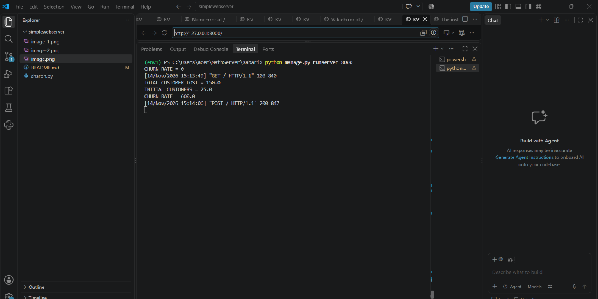
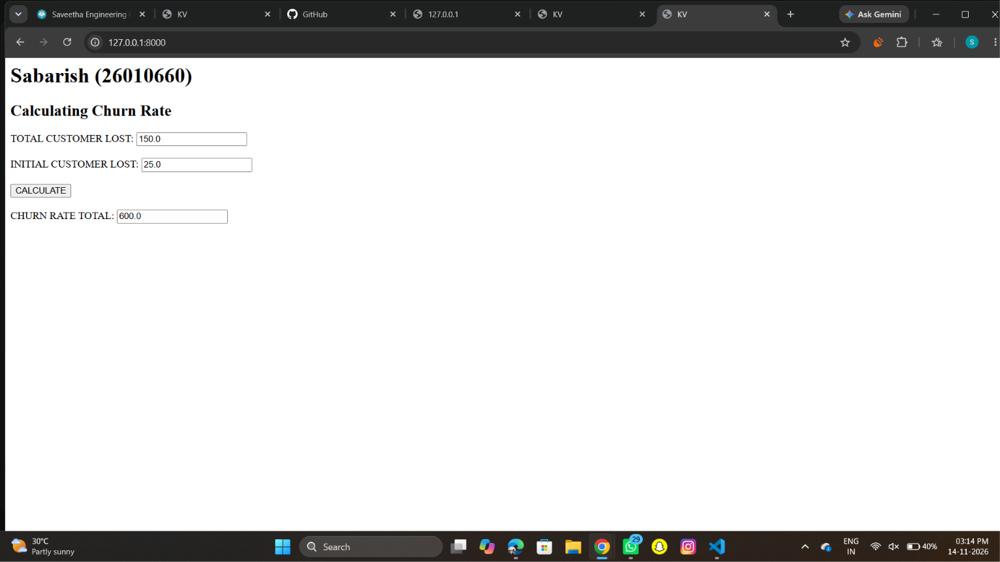

# Ex.03 Design a Website for Server Side Processing
## Date:14/11/2026

## AIM:
To create a web page to calculate Churn Rate using server-side scripts.

## FORMULA:
Churn Rate = (CustLost / InitCust) * 100
<br> InitCust --> Initial Customers Count
<br> CustLost --> Customers Lost Count

## DESIGN STEPS:

### Step 1:
Clone the repository from GitHub.

### Step 2:
Create Django Admin project.

### Step 3:
Create a New App under the Django Admin project.

### Step 4:
Create a HTML file to implement form based input and output.

### Step 5:
Create python programs for views and urls to perform server side processing.

### Step 6:
Receive input values from the form using request.POST.get().

### Step 7:
Calculate the Result using the given formula.

### Step 8:
Display the calculated result in the server console.

### Step 9:
Render the result to the HTML template.

### Step 10:
Publish the website in Localhost.

## PROGRAM:
```
custm.html

<html>
    <head>
        <title>KV</title>
    </head>
    <body>
        <h1>Sabarish (26010660)</h1>
        <h2>Calculating Churn Rate</h2>
        <form method="POST">
              
           
            <label>TOTAL CUSTOMER LOST:</label>
            <input type="number" value="{{ TOTAL_CUSTOMER_LOST }}" name="total">
            <br><br>
            
            <label>INITIAL CUSTOMER LOST:</label>
            <input type="number" value="{{ INITIAL_CUSTOMERS }}" name="initial">
         
          
            <br><br>
            
            <input type="submit" value="CALCULATE">
            <br><br>
            
            <label>CHURN RATE TOTAL:</label>
            <input type="number" value="{{ area }}"  >
        </form>
    </body>
</html>

views.py

django.shortcuts import render

def Churn_Rate_area(request):
    TOTAL_CUSTOMER_LOST = float(request.POST.get('total', '0'))
    INITIAL_CUSTOMERS = float(request.POST.get('initial', '0'))

    area =(TOTAL_CUSTOMER_LOST/INITIAL_CUSTOMERS) * 100 if request.method == 'POST' else 0
    print("TOTAL CUSTOMER LOST =", TOTAL_CUSTOMER_LOST)
    print("INITIAL CUSTOMERS =", INITIAL_CUSTOMERS)
    print("CHURN RATE =", area)

    return render(
        request,
        'myapp/custm.html',
        {'TOTAL_CUSTOMER_LOST': TOTAL_CUSTOMER_LOST, 'INITIAL_CUSTOMERS':  INITIAL_CUSTOMERS, 'area': area }
    )


urls.py

    from django.contrib import admin
from django.urls import path
from myapp import views
urlpatterns = [
    path('', views.Churn_Rate_area, name='Churn_Rate_area'),
]
```


## OUTPUT - SERVER SIDE:


## OUTPUT - WEBPAGE:



## RESULT:
The the web page to calculate Churn Rate using server-side scripts is created successfully.
